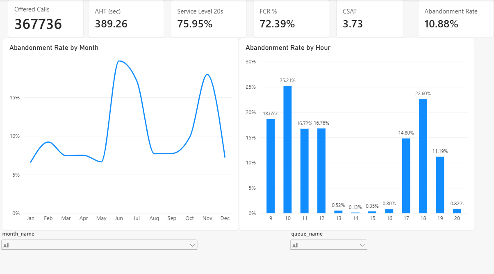
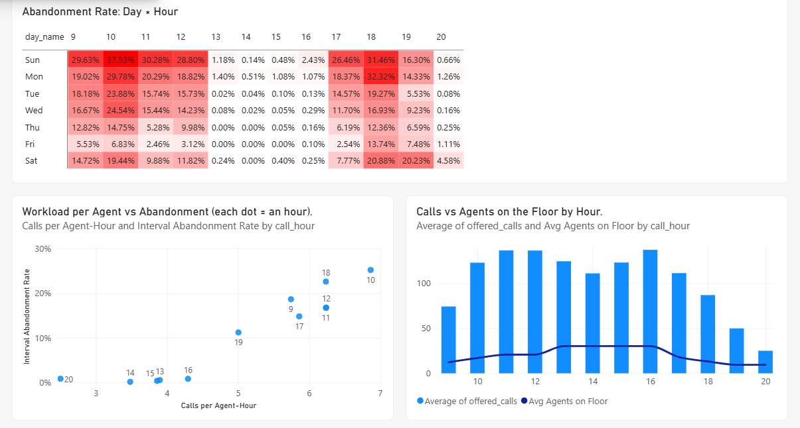
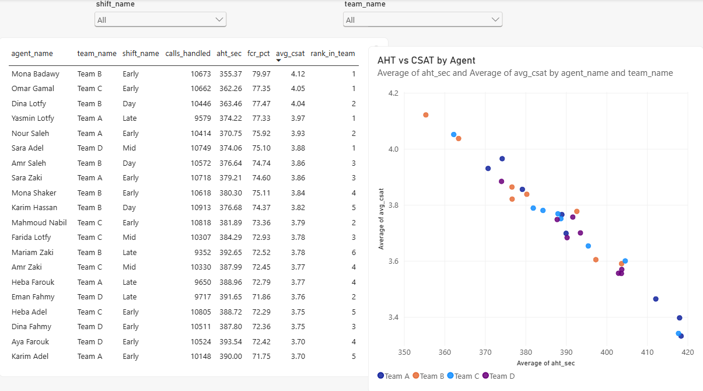
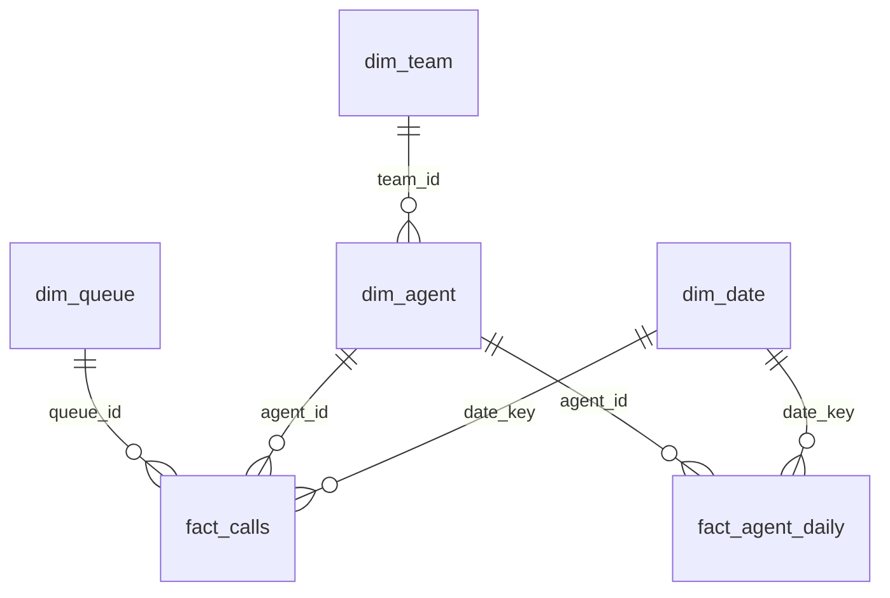

# Call Center Performance & Workforce Analytics
**SQL Server · Power BI · Python** — an end-to-end BI project: synthetic data → star schema → KPI views → analysis → dashboard.

> **All data is synthetic** (generated by `generate_data.py`, seed 42, fully reproducible). Agent names are fictional.
> It is built to behave like a real contact center so the analysis has real patterns to find.

## The business question
A contact center answers ~370k calls a year but **1 in 9 callers hangs up before an agent answers**.
Where and why does it happen, and what should operations change?

## Key findings *(full year 2025, exact values from the generated dataset)*
| KPI | Value |
|---|---|
| Offered calls | 367,736 |
| Abandonment rate | **10.88 %** (40,015 calls) |
| Service level (answered ≤ 20 s) | 75.95 % |
| AHT (answered calls) | 389 sec |
| FCR | 72.39 % |
| CSAT (35 % survey response) | 3.73 / 5 |
| Adherence / Shrinkage / Occupancy | 88.92 % / 18.56 % / 49.73 % |

1. **Abandonment is a peak-hour problem, not a general one.** 7 hours (09–12 and 17–19) carry 58 % of the volume but produce **98 % of all abandoned calls**. Hour 10:00 is the worst (25.2 %), then 18:00 (22.6 %). Between 13:00 and 16:00 abandonment is 0.47 % and service level is 98.5 %.
2. **The cause is workload per agent.** Intervals with fewer than 4 calls per agent on the floor abandon 0.16 %; 4–6 calls → 2.1 %; 6–8 calls → 22.5 %; 8+ calls → **40.3 %**. Abandonment does not rise gradually, it falls off a cliff once agents are saturated.
3. **Coverage is misaligned with demand.** ~30 agents are on the floor at 13:00–16:00 (3.7 calls per agent at 14:00) but only 17 at 10:00 (7.2 calls per agent) and 13 at 18:00 (6.6). Every 8-hour shift overlaps the early afternoon, so midday is overstaffed while the edges are thin.
4. **Seasonality and weekdays matter.** Busy months (Jun, Jul, Nov) abandon **18.3 %** vs 7.8 % in the other months. Sunday is the worst day (17.7 %, ~1,400 calls) and Thursday the best weekday (5.6 %).
5. **Quality gaps are concentrated.** Complaints (58.5 % FCR) and Technical Support (64.7 %) are the only queues below the average FCR; Technical Support also has the longest AHT (543 sec). A coaching list (below team average on both FCR and CSAT) gives 3 agents per team to target.
6. **Unusual days are detectable.** A z-score within month and day type flags 5 spike days (for example 2025-06-30 with 2,304 calls).

### What I would recommend
* **Re-shape coverage, not just headcount.** I tested moving shift start times with the same 32 agents (`--shift-mix`): abandonment only moved from 10.9 % to about 10.7 %. Because every 8-hour shift overlaps 13:00–16:00, shuffling starts is not enough. The real levers are **short peak shifts / part-timers for 09:00–12:00 and 17:00–19:00**, and moving **training and coaching (60-min sessions) into the 13:00–16:00 valley**.
* **Prepare for Jun, Jul and Nov** with extra temporary capacity; abandonment more than doubles in those months.
* **Target Complaints and Technical Support** with coaching and knowledge-base fixes to lift FCR.
* **Track calls per agent per hour as an operational alert** (above ~6 → escalate), it predicts abandonment better than occupancy does.

> Why occupancy looks low (≈50 %): it is handle time / logged time, and abandoned calls never consume handle time, so occupancy stays flat even when the floor is overloaded. Demand per agent is the better lens here.

## Dashboard (Power BI)
Three pages, built on the star schema with DAX measures (`powerbi_dax_measures.md`). Full PDF: [`CallCenter_Dashboard.pdf`](CallCenter_Dashboard.pdf) · Power BI file: `CallCenter_BI_Dashboard.pbix`.

**1. Overview** — headline KPIs, abandonment by month and by hour, filters for month and queue.


**2. Root Cause** — day × hour heatmap (worst cell: Sunday 10:00 at 37.5 %), workload per agent vs abandonment, and calls vs agents on the floor by hour.


**3. Agents & Teams** — agent scorecard with rank in team, and AHT vs CSAT by agent (slower handling goes with lower satisfaction), filters for team and shift.


*Note:* the workforce measures (Adherence, Shrinkage, Occupancy) are built and validated, a dedicated WFM page is planned.

## Architecture
```
generate_data.py ──CSV──► 01_schema_and_load.sql ──► star schema (SQL Server)
                                                       │
                          02_kpi_views.sql  ◄──────────┘   layered KPI views
                          03_analysis_queries.sql          window functions, root cause
                          04_data_quality_checks.sql       13 integrity checks (all must PASS)
                                   │
                                   ▼
                        Power BI (Import) + DAX measures  ──► 3-page dashboard (+ PDF and screenshots)
                        validate_kpis.py  ──► pandas reconciliation of the headline KPIs
```

### Data model (star schema)

| Table | Grain | Rows |
|---|---|---|
| `fact_calls` | one row per offered call (NULL `agent_id` = abandoned) | ~367k |
| `fact_agent_daily` | one row per scheduled agent per day (schedule, logged, break, training, absence) | ~10k |
| `dim_date`, `dim_agent`, `dim_team`, `dim_queue` | dimensions (agent has shift name and start hour) | 365 / 32 / 4 / 4 |

## KPI definitions
| KPI | Definition |
|---|---|
| Abandonment rate | abandoned calls / offered calls |
| AHT | average handle time of **answered** calls (sec) |
| Service level | calls answered within 20 s / offered calls |
| FCR | first-call-resolved / answered calls |
| CSAT | average score of survey responses (only ~35 % of callers respond) |
| Adherence | logged minutes / scheduled minutes |
| Shrinkage | (break + training + scheduled minutes of absent agents) / scheduled minutes |
| Occupancy | handle time / logged time |

## How the synthetic data is made (realism)
* 32 agents, 4 teams, 4 shift patterns (8 h each), Sunday–Thursday, plus half the roster on Fri/Sat (Egypt weekend).
* Calls are only answered by agents who are **scheduled and present that hour**, so the two fact tables always agree (check #07 and #08 in script 04).
* **Wait times come from an Erlang-C queueing model**: when offered load approaches the number of available agents, waits explode and callers abandon (patience is exponential).
* Seasonality (Jun/Jul/Nov), weekday pattern, 5 incident spike days, queue mix and queue difficulty, a hidden agent-skill and team effect on AHT/FCR/CSAT/adherence, and a 35 % survey response rate.
* Change it with `python generate_data.py --shift-mix 9:9,10:8,11:6,13:9 --out data_whatif` to run what-if scenarios.

## How to run
1. **Install:** Python 3.10+, SQL Server (Express/Developer) + SSMS, Power BI Desktop (Windows). Then `pip install -r requirements.txt`.
2. `python generate_data.py` → creates `./data` with 6 CSV files.
3. Copy `data` to a folder SQL Server can read, for example `C:\callcenter-bi\data\`. **Avoid Desktop/Downloads/Documents** (the SQL Server service account cannot read them).
4. In SSMS run, in order: `01_schema_and_load.sql` (edit `@path` first) → `02_kpi_views.sql` → `04_data_quality_checks.sql` (all PASS) → `03_analysis_queries.sql` (run query by query).
5. `python validate_kpis.py` and compare with the SQL views: the headline KPIs must match.
6. In Power BI: Get Data → SQL Server → import the tables listed in `powerbi_dax_measures.md`, build the relationships, add the measures.

## Project structure
```
generate_data.py            synthetic data generator (seeded, what-if capable)
CallCenter_BI_Dashboard.pbix  Power BI report (3 pages)
CallCenter_Dashboard.pdf    dashboard export
screenshots/                dashboard page images used in this README
01_schema_and_load.sql      tables, constraints, BULK INSERT, indexes
02_kpi_views.sql            7 views: daily, hourly, agent-day, WFM monthly, agent, queue, interval staffing
03_analysis_queries.sql     12 business questions (LAG, ROW_NUMBER, RANK, running totals, z-score, Pareto)
04_data_quality_checks.sql  13 data-quality checks
powerbi_dax_measures.md     model, relationships, all DAX measures, page plan
validate_kpis.py            pandas reconciliation of the KPIs
```

## Skills demonstrated
Dimensional modelling (star schema, grain, FK/CHECK constraints) · T-SQL (CTEs, window functions, layered views, avoiding join fan-out, covering indexes, BULK INSERT) · data quality validation · KPI design for contact centers (service level, AHT, FCR, adherence, shrinkage, occupancy) · root-cause and capacity analysis · Power BI (DAX, time intelligence, conditional formatting) · Python (pandas/numpy simulation, queueing theory) · reproducibility.

## Limitations (be honest about these in interviews)
* Synthetic data: the patterns are designed in; real data is messier (intraday schedules, transfers, callbacks, IVR abandonment).
* Agents are assumed to cover every hour of their shift unless absent for the day; late logins and intraday breaks are not modelled hourly.
* Handle time is attributed to the hour the call arrived.
* One year of data only, so no year-over-year comparison.
